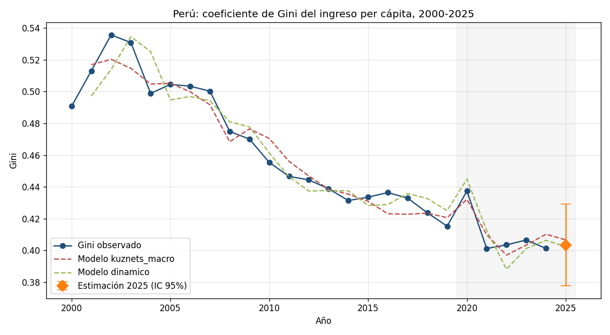
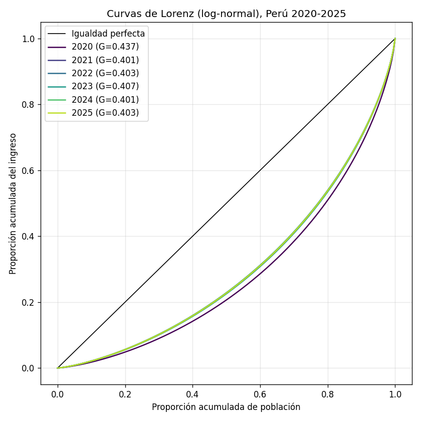
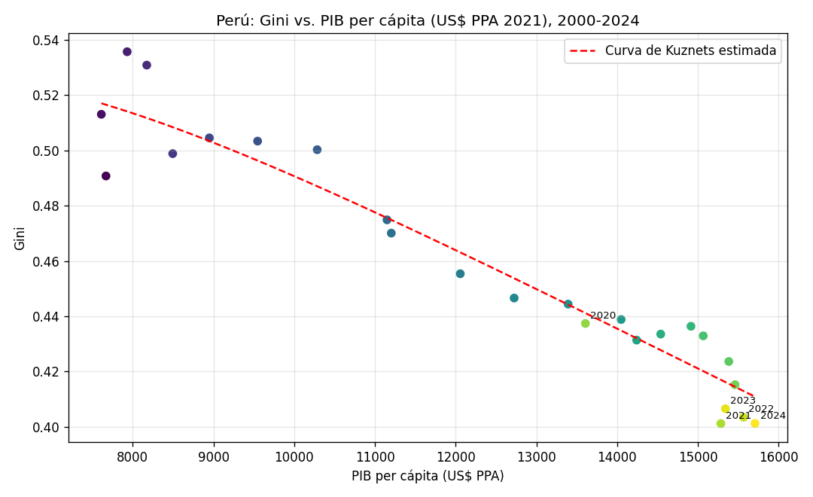

# Coeficiente de Gini – Perú 2020-2025

Se analiza y estima la desigualdad del ingreso en el Perú (coeficiente de Gini) para el periodo **2020-2025**. Usa la serie histórica 2000-2024 para estimar modelos econométricos y obtiene una **estimación para 2025**, último año sin dato oficial de Gini publicado.

## Resultados principales

| Año | Gini | Fuente | Var. (p.p.) | Theil | Ratio de Palma |
|-----|------|--------|-------------|-------|----------------|
| 2020 | 0.4374 | Observado | – | 0.335 | 2.27 |
| 2021 | 0.4012 | Observado | -3.62 | 0.277 | 1.86 |
| 2022 | 0.4035 | Observado | +0.23 | 0.280 | 1.88 |
| 2023 | 0.4066 | Observado | +0.31 | 0.285 | 1.91 |
| 2024 | 0.4013 | Observado | -0.53 | 0.277 | 1.86 |
| **2025** | **0.4034** | **Estimado** | +0.22 | 0.280 | 1.88 |

- **Gini 2025 estimado: 0.403** (IC 95 %: 0.378 – 0.429), promedio de tres modelos.
- La pandemia elevó el Gini a 0.437 en 2020 (+2.2 p.p. respecto a 2019); en 2021 la recuperación lo redujo a 0.401, y desde entonces se mantiene estable en torno a 0.40.
- Curva de Kuznets: en el rango de ingresos observado (US$ 7,600 – 15,700 PPA per cápita), la desigualdad cae a medida que crece el ingreso.



| Curvas de Lorenz | Curva de Kuznets |
|---|---|
|  |  |

## Metodología

1. **Datos** (`data/peru_gini_macro_2000_2025.csv`)
   - `gini`: Gini del ingreso per cápita, Banco Mundial – Poverty and Inequality Platform (PIP), basado en la ENAHO del INEI (vía Our World in Data).
   - `pib_pc_ppp`: PIB per cápita (US$ PPA constantes 2021), Banco Mundial.
   - `desempleo`: tasa de desempleo (% de la fuerza laboral, estimación modelada OIT), vía Our World in Data.
   - `crec_pib`: crecimiento del PIB real (%), Banco Mundial (NY.GDP.MKTP.KD.ZG).
   - `inflacion`: inflación IPC (%), Banco Mundial (FP.CPI.TOTL.ZG).

2. **Modelos econométricos** (MCO con errores estándar HAC de Newey-West, muestra 2000-2024)
   - *Curva de Kuznets ampliada*:
     `Gini_t = β0 + β1·ln(PIBpc_t) + β2·ln(PIBpc_t)² + β3·Desempleo_t + β4·Inflación_t + ε_t` (R² aj. = 0.94)
   - *Modelo dinámico de ajuste parcial*:
     `Gini_t = α + ρ·Gini_{t-1} + γ1·CrecPIB_t + γ2·Desempleo_t + γ3·Inflación_t + ε_t` (R² aj. = 0.92)
   - *ARIMA(1,1,0)* sobre la serie del Gini, como referencia univariada.

   El Gini 2025 se obtiene con los valores macroeconómicos de 2025 y es el promedio de los tres modelos, con su intervalo de predicción al 95 %.

3. **Indicadores derivados**: suponiendo que el ingreso sigue una distribución log-normal (`G = 2Φ(σ/√2) − 1`), se recuperan σ, la curva de Lorenz, el índice de Theil, el de Atkinson (ε = 1), el ratio de Palma y la participación de cada quintil.

4. **Microsimulación**: se generan 200 000 ingresos log-normales por año y se verifica que el Gini calculado sobre los microdatos reproduce el Gini para el periodo 2025.


## Uso

```bash
pip install -r requirements.txt
python main.py               # usa los datos incluidos en data/
python main.py --actualizar  # descarga los datos más recientes
```

La función `src.gini.gini(ingresos, pesos)` también sirve con microdatos de la ENAHO, por ejemplo `gini(sumaria["inghog2d"] / sumaria["mieperho"], sumaria["factor07"] * sumaria["mieperho"])`.

## Limitaciones

- El Gini de 2025 es una **estimación del modelo**: el INEI/Banco Mundial todavía no lo publican.
- La muestra es pequeña (25 observaciones anuales); los coeficientes describen asociaciones, no efectos causales. El signo negativo del desempleo en el modelo de Kuznets probablemente recoge el periodo posterior a 2020 (más desempleo con menor Gini) y no debe leerse como un efecto estructural.
- Los indicadores derivados (Theil, Palma, quintiles) suponen una distribución log-normal; los valores calculados directamente sobre la ENAHO pueden diferir.
